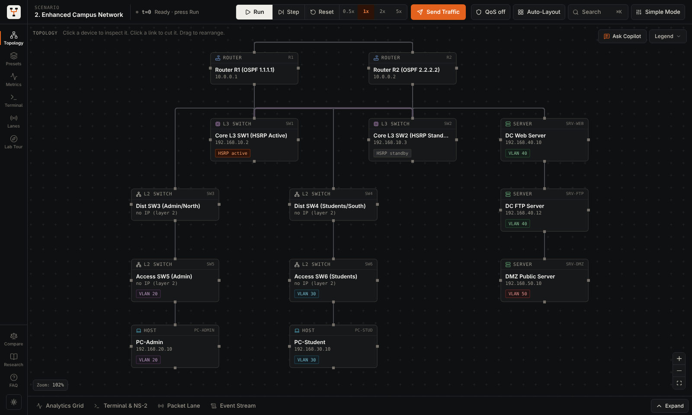
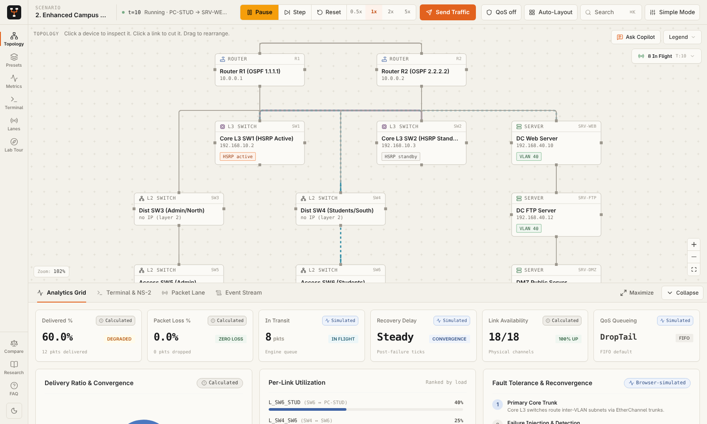
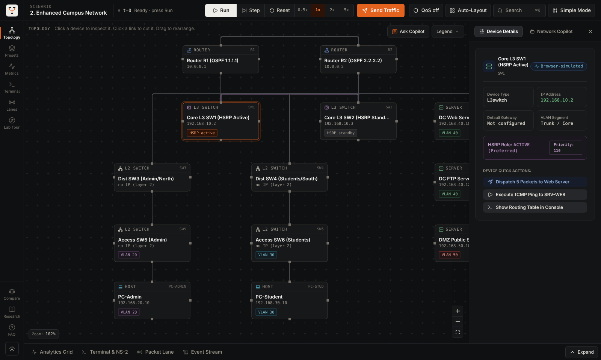

# Redundant Data Center Campus Network

An interactive browser lab that shows how a redundant campus and data center network behaves when things go wrong. Cut a link, kill a gateway, flood a queue, and watch the network reroute, fail over and recover in real time.

Built as our **Computer Networks (CN) mini project** at Fr. Conceicao Rodrigues College of Engineering (CRCE), Mumbai.



---

## Team

| Name | Roll No. |
|---|---|
| Meet Navin Mangaonkar | 10616 |
| Yash Masaye | 10617 |
| Sanika | 10613 |

TE Computer Engineering, Fr. CRCE, Mumbai

---

## What this project is

A normal campus network has one core router and one path to everything. If that path breaks, the whole campus goes offline. Our project takes that "single path" design from a published research paper and compares it with a **redundant dual core design** (two routers, two core switches, HSRP gateway failover, OSPF rerouting and EtherChannel trunks).

Instead of only showing a static Cisco Packet Tracer file, we built a web app where you can actually play with both networks:

- send packets between any two devices and watch them hop
- click any link to cut it and see what happens to the traffic
- compare how long the network takes to recover
- turn QoS on and off and see which traffic survives congestion
- check that VLAN and ACL rules really block what they should

> **Honest note:** this is a browser simulation written in TypeScript. It is **not** connected to Cisco Packet Tracer, does not run Cisco IOS and does not talk to real hardware. Every number on screen is labelled as *Browser simulated*, *Calculated*, *Imported* or *Unavailable* so nothing is passed off as a real measurement.

---

## The network we model

```
        R1 (OSPF 1.1.1.1) ─────────────── R2 (OSPF 2.2.2.2)
              │      ╲                 ╱      │
              │        ╲             ╱        │         (each router links to both cores)
        SW1  Core L3  ════ Po1 ════  SW2  Core L3
        HSRP active, pri 110         HSRP standby, pri 100
              │   ╲                 ╱   │
              │     ╲             ╱     │                (each core links to both dist switches)
        SW3 Dist (Admin)         SW4 Dist (Students)
              │                         │
        SW5 Access, VLAN 20      SW6 Access, VLAN 30
              │                         │
        PC-Admin                 PC-Student
        192.168.20.10            192.168.30.10

  Data center block:
        DC Web  192.168.40.10   linked to SW1 and SW2
        DC FTP  192.168.40.12   linked to SW1
        DMZ     192.168.50.10   linked to SW2
```

| VLAN | Purpose | Subnet |
|---|---|---|
| 10 | Management / core SVIs | 192.168.10.0/24 |
| 20 | Admin department | 192.168.20.0/24 |
| 30 | Students | 192.168.30.0/24 |
| 40 | Data center servers | 192.168.40.0/24 |
| 50 | DMZ (public facing) | 192.168.50.0/24 |

Key ideas shown in the simulation:

- **HSRP**: SW1 (priority 110) is the active default gateway, SW2 (priority 100) takes over if SW1 or its uplinks fail.
- **OSPF style rerouting**: shortest path (Dijkstra) is recomputed after a fixed reconvergence delay, so you can see the short window of packet loss before traffic moves to the backup path.
- **EtherChannel (Po1)**: bundled trunk between the two core switches.
- **QoS**: strict priority queueing keeps voice / LMS traffic alive while bulk traffic gets tail dropped.
- **ACL_VLAN30_IN**: students can reach the web server but FTP and the management VLAN are blocked.

---

## Scenarios included

| # | Scenario | What to look for |
|---|---|---|
| 1 | Research Paper Baseline | Single path design. Cut the uplink and the campus goes fully offline. |
| 2 | Enhanced Campus Network | The dual core redundant design. Primary path runs through SW1. |
| 3 | Normal Student Traffic | Steady traffic from PC-Student to the web server. Zero loss. |
| 4 | Primary Link Failure | SW1 to SW4 uplink dies. Short loss during reconvergence, then traffic moves to SW2. |
| 5 | Recovery After Failure | The link comes back and the path goes back to SW1. |
| 6 | Traffic Congestion and QoS | Voice vs bulk traffic on a busy link, with and without QoS. |
| 7 | VLAN Isolation and ACL | HTTP to the web server is allowed, FTP from students is denied. |
| 8 | Server Unavailable | Packets reach the data center but the server is down. |

There is also a **7 step guided Lab Tour** that walks through normal traffic, failure, packet drops, reconvergence and recovery automatically. Handy for the viva demo.

---

## Features

- **Live topology canvas**: drag devices around, click a device to inspect it, click a link to cut or restore it. The active forwarding path lights up while packets move.
- **Simple Mode / Nerd Mode**: Simple Mode keeps it readable for anyone. Nerd Mode shows IPs, MACs, interfaces, routing tables and queue internals.
- **Analytics grid**: delivery %, packet loss, packets in flight, recovery delay, link availability, per link utilization and convergence charts.
- **Packet Lane**: hop by hop view of every packet and exactly where and why it was dropped.
- **Diagnostic terminal**: a small shell that understands commands like `ping`, `traceroute`, `fail link`, `show route`, `show vlan`, `qos on` and `export json`. Type `help` to see them all. (It looks like a router CLI but it is our own engine, not Cisco IOS.)
- **NS-2 script generator**: exports the current topology as an equivalent NS-2 Tcl script and trace file. The app only generates these, it does not run NS-2.
- **Network Copilot**: rule based helper that answers questions about the current scenario using only verified facts. No AI model is called.
- **Compare, Research and FAQ pages**: baseline vs enhanced comparison table, full citations and answers to common viva questions.
- **Light and dark themes**, command palette (`⌘K` / `Ctrl+K`) and keyboard shortcuts.





### Keyboard shortcuts

| Key | Action |
|---|---|
| `Space` | Run / pause |
| `R` | Reset the current scenario |
| `M` | Switch Simple / Nerd Mode |
| `⌘K` or `Ctrl+K` | Open search and commands |

---

## Tech stack

| Part | Used |
|---|---|
| UI | React 19, TypeScript, Tailwind CSS |
| Topology canvas | React Flow (`@xyflow/react`) |
| Charts | Recharts |
| Icons | Lucide |
| Build tool | Vite 6 |
| Tests | Vitest (engine unit tests), Playwright (browser end to end) |
| Fonts | IBM Plex Sans and IBM Plex Mono |

---

## Run it locally

You need **Node.js 18 or newer** (20+ recommended).

```bash
git clone https://github.com/How2Invade/cn_mini.git
cd cn_mini
npm install
npm run dev
```

Then open http://localhost:5173.

### Scripts

| Command | What it does |
|---|---|
| `npm run dev` | Starts the dev server with hot reload |
| `npm run build` | Type checks and builds the production site into `dist/` |
| `npm run preview` | Serves the production build locally |
| `npm test` | Runs the simulation engine unit tests |
| `npm run test:e2e` | Runs the Playwright browser tests |

---

## Deploying on Vercel

The project is a plain static Vite app, so Vercel picks it up with no extra config.

1. Push the repo to GitHub.
2. On Vercel, click **Add New → Project** and import `cn_mini`.
3. Vercel auto detects **Vite**. Keep the defaults:
   - Build command: `npm run build`
   - Output directory: `dist`
   - Install command: `npm install`
4. Click **Deploy**.

---

## Project structure

```
cn_mini/
├── index.html                 page shell, fonts, meta tags
├── public/favicon.svg
├── src/
│   ├── App.tsx                layout: left rail, top bar, canvas, dock
│   ├── index.css              global styles, canvas and scrollbar tweaks
│   ├── context/
│   │   └── SimulationContext.tsx   app state, tick loop, terminal commands
│   ├── simulation/
│   │   ├── engine.ts          discrete event engine (queues, drops, HSRP, reconvergence)
│   │   ├── graph.ts           Dijkstra shortest path
│   │   ├── presets.ts         the 8 scenarios, devices, links and layouts
│   │   ├── ns2Generator.ts    NS-2 Tcl and trace export
│   │   └── types.ts
│   └── components/
│       ├── shell/             left rail, top bar, presets drawer, command palette, inspector
│       ├── dock/              analytics, terminal, packet lane
│       └── ...                canvas, nodes, comparison, research, FAQ, guided tour
├── tests/                     Playwright end to end tests
└── docs/                      design notes, scenario specs, demo script, screenshots
```

---

## How the simulation works (short version)

1. Every scenario defines devices (routers, L3 switches, L2 switches, servers, PCs) and links with a cost and a queue size.
2. The engine runs in **ticks** (about 250 ms each at 1x speed). Each tick, new packets are injected and every packet in flight moves one hop.
3. Routes come from **Dijkstra** over the links that are currently up. When a link goes down, routes are not updated instantly. They wait for a reconvergence delay, like OSPF does, so you see real looking loss before recovery.
4. Each link has a buffer. When it is full, packets are **tail dropped**. With QoS on, high priority packets always leave the queue first.
5. ACL rules are checked at the gateway, so blocked traffic is dropped with a clear reason (`vlan_policy_denied`).
6. All counters feed the analytics grid, packet lane and event log, so every drop can be traced back to a cause.

---

## References

- Preetham N Varne, Priyanka J, Snehith Shetty V, Tejus A K, Naveen Chandra Gowda, *"Campus Network Design and Implementation using Cisco Packet Tracer"*, International Journal of Computational Learning & Intelligence, Vol. 2, Issue 4, 2023. DOI: [10.5281/zenodo.10254264](https://doi.org/10.5281/zenodo.10254264) (CC BY 4.0). Used for the baseline design.
- Anton-Alexandru Demian, *"Redundant Data Center–Campus Network"*, bachelor's thesis, Politehnica University of Timisoara. Repository: [antondemian/redundant-data-center-campus-network](https://github.com/antondemian/redundant-data-center-campus-network). Used for the enhanced topology, addressing plan, HSRP, OSPF and ACL setup. Original `.pkt` files are not redistributed here.

Full details are in [ATTRIBUTION.md](ATTRIBUTION.md).

---

<sub>Computer Networks mini project · TE Computer Engineering · Fr. CRCE, Bandra, Mumbai</sub>
